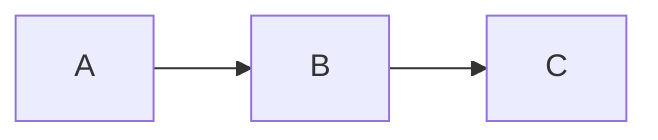

Inline: **bold**, *italic*, ~~strike~~, ==highlight==, `code`, %%hidden comment%% and a #tag/nested.
A soft
line break, an [external link](https://example.com) and a [markdown link](Workflow%20Payoff.md).
Footnote here[^1].

## Tables

| Name | Value | Link |
| :--- | ---: | --- |
| alpha | 1 | [[Home\|home]] |
| beta | 22 | [[Workflow Payoff]] |

## Tasks

- [x] done
- [ ] todo
- [/] in progress
    - nested item

1. one
2. two

## Callouts

> [!warning]- Foldable warning
> Hidden until opened, with **markdown**.

> [!tip] Nested
> Outer text
> > [!quote]
> > Inner quote callout

> [!custom-thing] Custom type
> Falls back to the note icon.

> Plain blockquote.
> Second line ^quote-block

## Code

```rust
fn main() {
    println!("hello {}", 1 + 2);
}
```



## Math

Inline $e^{i\pi} + 1 = 0$ and display:

$$
\int_0^1 x^2\,dx = \tfrac13
$$

## Media

![[diagram.svg]]
![[gradient one.png|200]]


## Embeds

![[Workflow Payoff#Details]]

![[Workflow Payoff]]

---

[^1]: The footnote text.
